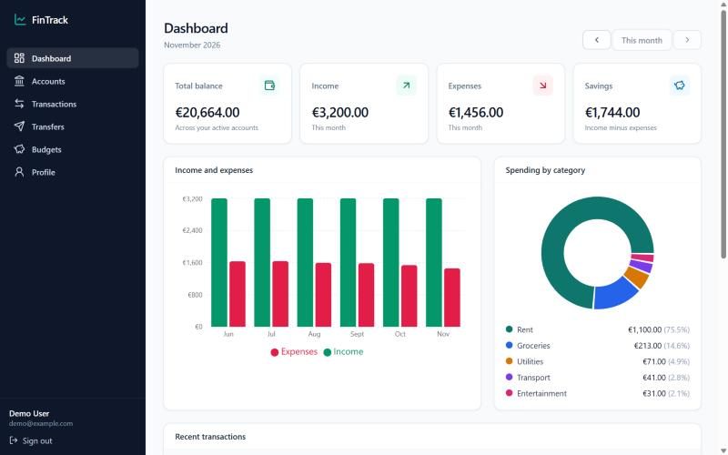
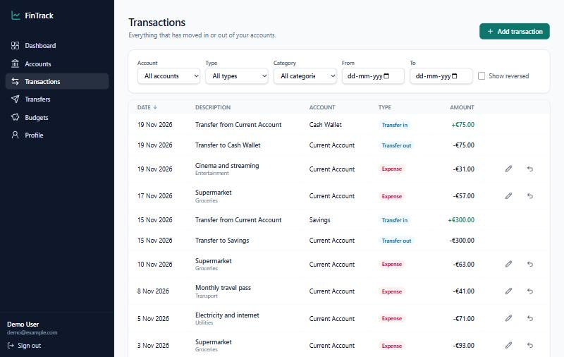
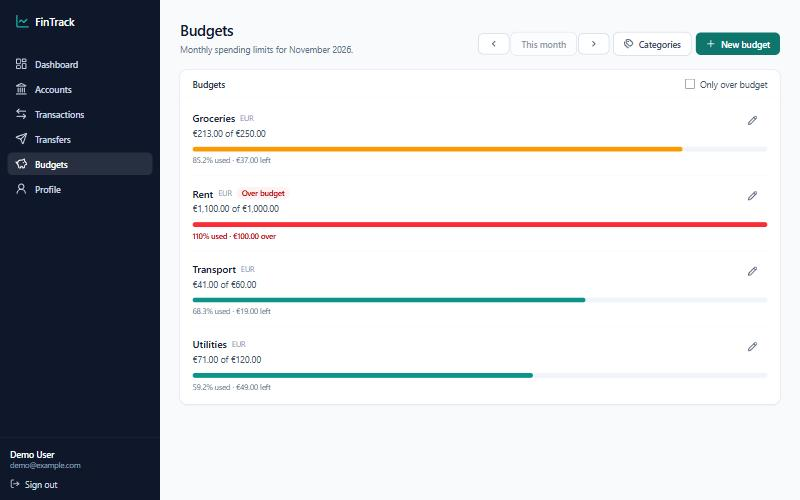
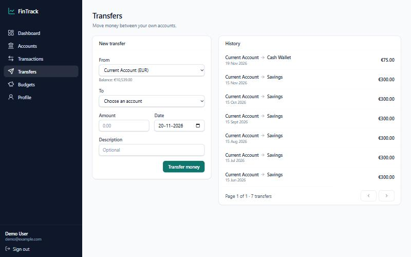
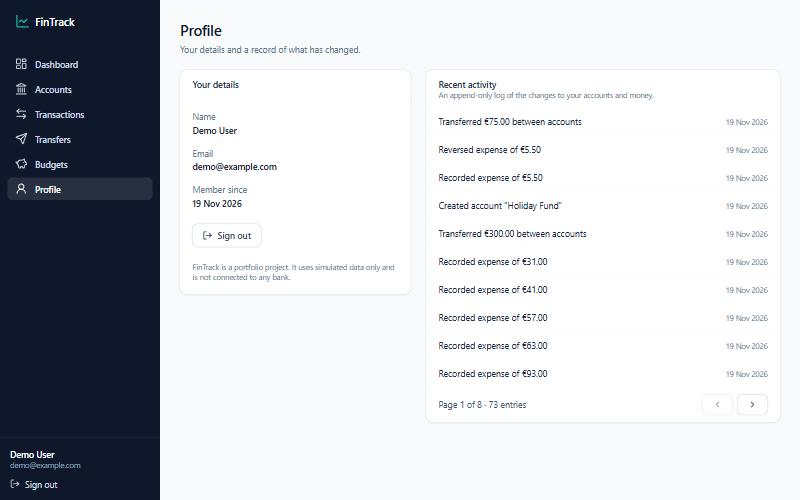
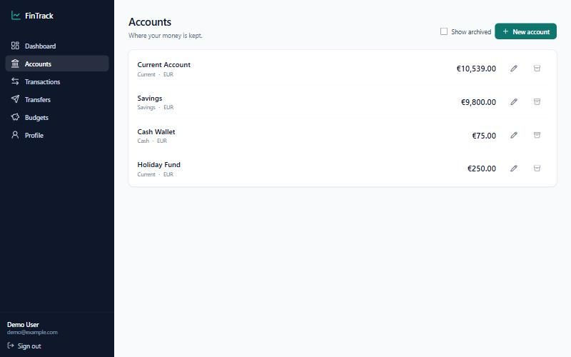
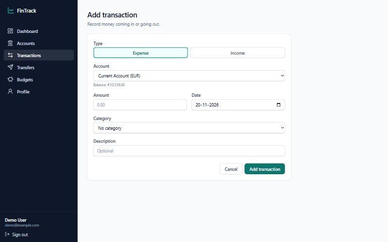
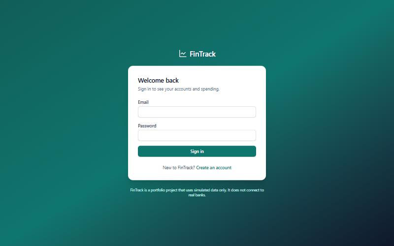
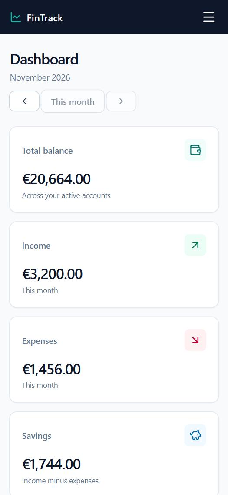
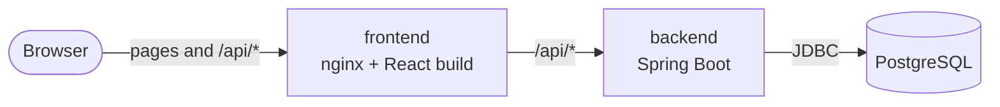

# FinTrack – Personal Finance and Transaction Management System

[](https://github.com/TanviC1314/fintrack-personal-finance-system/actions/workflows/ci.yml)

> A portfolio project that uses **simulated data only**. It is not connected to any bank, does not
> process real payments and stores no card details. It has not been security audited and is **not
> production ready**; see [Security notes and limitations](#security-notes-and-limitations).

FinTrack lets a user manage several accounts, record income and expenses, move money between their
own accounts, set monthly category budgets and see where their money goes. The focus is the
backend: correct money handling, database integrity under concurrency, isolated user data, secure
APIs and meaningful automated tests.



## Problem statement

Spreadsheets and notes make it easy to lose track of spending and hard to trust balances.
FinTrack explores how a small finance system can keep balances provably consistent (a transfer can
never leave money debited but not credited, and two requests cannot overdraw an account), keep
each user's data isolated from every other user's, and turn raw transactions into useful monthly
summaries computed by the database.

## Features

- **Authentication.** Registration and login with BCrypt-hashed passwords and stateless JWT access tokens.
- **Accounts.** Current, savings and cash accounts in any ISO currency; rename and archive.
- **Transactions.** Income and expenses with category, description and date; filter by account, type,
  category and date range; sort and page; edit; reverse (history is kept, nothing is deleted).
- **Transfers.** Atomic transfers between a user's own accounts, with sufficient-funds checks,
  deadlock-free locking and **idempotency keys** so a retried request never moves money twice.
- **Dashboard.** Total balance, monthly income, expenses and savings, income-versus-expense trend and
  spending by category, all aggregated in SQL.
- **Categories and budgets.** Monthly budgets per category with spent, remaining, percentage used and an
  over-budget flag.
- **Audit log.** An append-only record of important financial operations, enforced by a database trigger.
- **Web app.** Responsive React interface with validated forms, loading, empty and error states, and notifications.

## Screenshots

| | |
| --- | --- |
|  |  |
|  |  |
|  |  |
|  |  |

All screenshots use made-up demo data (see [docs/screenshots](docs/screenshots/README.md)).

## Technology stack

| Area | Technology |
| --- | --- |
| Backend | Java 21, Spring Boot 3.5 (Web, Data JPA, Security, Validation), Hibernate, Maven |
| Database | PostgreSQL 16, Flyway migrations |
| Backend tests | JUnit 5, Mockito, Spring Boot Test, MockMvc, Testcontainers, JaCoCo |
| API documentation | springdoc OpenAPI / Swagger UI, Postman collection |
| Frontend | React 19, TypeScript, Vite, Tailwind CSS 4, TanStack Query, React Hook Form, zod, Recharts |
| Frontend tests | Vitest, Testing Library |
| DevOps | Docker, Docker Compose, nginx, GitHub Actions |

## Architecture



The backend is layered, **Controller → Service → Repository → Database**, organised by feature.
Controllers handle HTTP only, services own the business rules and transactions, repositories own
persistence, and entities never leave the service layer. Every query that returns user data is
scoped to the caller. See [docs/ARCHITECTURE.md](docs/ARCHITECTURE.md) for the full diagrams
(system, layers, the sequence of a money transfer, the frontend) and a table of design decisions with
their trade-offs.

### How balances stay correct

`accounts.current_balance` is a cached value kept in step with a ledger of transactions. Every change runs
in one database transaction that first takes a row lock on the account (`SELECT … FOR UPDATE`), so
concurrent requests are serialised. A transfer locks both accounts in ascending id order, so two
opposite transfers cannot deadlock. A `CHECK (current_balance >= 0)` is the last line of defence.
Tests assert the invariant *opening balance + ledger = cached balance* under concurrent load.

## Database design

PostgreSQL schema managed by Flyway (`backend/src/main/resources/db/migration`, versions V1–V9):
`users`, `accounts`, `transactions`, `transfers`, `categories`, `budgets` and `audit_log`, with foreign keys,
unique constraints, `CHECK` constraints, `NUMERIC(19,2)` for money and indexes for the common queries.
The ER diagram and the reasoning behind the balance design are in
[docs/DATABASE_DESIGN.md](docs/DATABASE_DESIGN.md).

## API documentation

- **Swagger UI:** <http://localhost:8080/swagger-ui.html> (when the stack is running)
- **OpenAPI description:** <http://localhost:8080/v3/api-docs>, and a stored copy in [docs/openapi.json](docs/openapi.json)
- **Postman:** import [docs/postman/FinTrack.postman_collection.json](docs/postman/FinTrack.postman_collection.json)
  and the local environment file. The collection runs top to bottom (39 requests, each with assertions).

Errors use RFC 9457 problem details. Another user's resource returns `404`, never `403`, so its existence is not revealed.

| Area | Endpoints |
| --- | --- |
| Authentication | `POST /api/v1/auth/register`, `POST /api/v1/auth/login`, `GET /api/v1/users/me` |
| Accounts | `POST`, `GET /api/v1/accounts`; `GET`, `PUT`, `DELETE` (archive) `/api/v1/accounts/{id}` |
| Transactions | `POST`, `GET /api/v1/transactions` (filter incl. `q` text search, sort, page); `GET`, `PUT`, `DELETE` (reverse) `/api/v1/transactions/{id}` |
| Transfers | `POST /api/v1/transfers` (requires `Idempotency-Key`), `GET /api/v1/transfers` |
| Categories | `POST`, `GET /api/v1/categories`; `PUT`, `DELETE /api/v1/categories/{id}` |
| Budgets | `POST`, `GET /api/v1/budgets`; `PUT /api/v1/budgets/{id}` |
| Dashboard | `GET /api/v1/dashboard/summary`, `/monthly`, `/categories` |
| Audit log | `GET /api/v1/audit-logs` |

## Installation and setup

### Quick start with Docker (recommended)

You need Docker. This starts PostgreSQL, the API and the web app.

```bash
git clone <repository-url> && cd fintrack-personal-finance-system
cp .env.example .env
```

Edit `.env` and set your own `POSTGRES_PASSWORD` and `JWT_SECRET` (at least 32 characters, for example
from `openssl rand -base64 48`). Compose refuses to start without them; there are no default secrets.

```bash
docker compose up -d --build --wait
```

| Service | URL |
| --- | --- |
| Web app | <http://localhost:3000> |
| API and Swagger UI | <http://localhost:8080/swagger-ui.html> |
| PostgreSQL | `localhost:5432` |

All ports are bound to `localhost` only. Register an account in the web app to begin. Stop with
`docker compose down` (add `-v` to also delete the database volume).

### Running without Docker for the apps

For development, run only the database in Docker and the two apps on your machine. You need JDK 21 and Node 22.

```bash
docker compose up -d postgres
```

```bash
# Backend (Linux/macOS: use export; PowerShell: $env:DB_PASSWORD = "...")
cd backend
export DB_PASSWORD=<your POSTGRES_PASSWORD> JWT_SECRET=<at least 32 characters>
./mvnw spring-boot:run
```

```bash
# Frontend (Vite proxies /api to http://localhost:8080)
cd frontend
npm ci
npm run dev        # http://localhost:5173
```

## Running the tests

| Suite | Command | Docker needed |
| --- | --- | --- |
| Backend unit tests | `cd backend && ./mvnw test` | No |
| Backend unit and integration tests with coverage | `cd backend && ./mvnw verify` | Yes (Testcontainers) |
| Frontend lint, tests and build | `cd frontend && npm run lint && npm test && npm run build` | No |
| Full-stack smoke test | `bash .github/scripts/smoke-test.sh http://localhost:3000` | Needs the stack running |

On the last full run: **146 backend unit tests, 255 backend integration tests and 87 frontend tests passed**,
and JaCoCo reported **about 98 % instruction coverage** of the backend (98.2–98.3 % across runs; unit and integration
tests together; the report is in `backend/target/site/jacoco/index.html`). Coverage is a measure of what the tests execute, not of how
good they are, so the tests that matter most are the behavioural ones:

- **Concurrency:** eight simultaneous 30.00 expenses on a 100.00 account let exactly three succeed; opposite
  transfers at the same moment neither deadlock nor lose money; identical retries move money once.
- **Rollback:** a failure injected after both balances changed and every row was written leaves no trace.
- **Isolation:** another user's data is never visible or changeable, and looks the same as data that does not exist.
- **Data migration:** the migration that turned free-text labels into categories is tested against rows created
  under the old schema.
- Several of these tests were confirmed to fail when the code they protect is deliberately broken.

## Continuous integration

[`.github/workflows/ci.yml`](.github/workflows/ci.yml) runs on every push to `main` and every pull request:
build and unit tests, integration tests with coverage, frontend lint, tests and build, then the Docker images are
built, the full stack is started and the smoke test runs through nginx. Any failing build or test fails the pipeline.
Results are shown in the job summary and the reports are uploaded as artifacts. The workflow passes `actionlint`;
the badge above points at the GitHub repository.

## Project structure

```
backend/      Spring Boot application, Flyway migrations, tests, Dockerfile
frontend/     React + TypeScript application, nginx configuration, Dockerfile
docs/         ARCHITECTURE.md, DATABASE_DESIGN.md, openapi.json, postman/, screenshots/
.github/      CI workflow and its scripts
docker-compose.yml   PostgreSQL, backend and frontend
PROJECT_PROGRESS.md  The delivery checklist
```

## Security notes and limitations

What is in place: BCrypt password hashing; JWT verified on every request; all data scoped to the authenticated user;
parameterised queries through JPA; input validation on every request; a restrictive Content-Security-Policy and other
security headers from nginx; secrets only from environment variables, with no defaults.

Known limitations, stated plainly:

- The access token is kept in `localStorage`, so a cross-site-scripting bug would expose it. Tokens last one hour and
  there is no refresh or revocation. A production system would use short-lived tokens with an httpOnly refresh cookie.
- There is no rate limiting or lockout on login, no email verification and no password reset.
- Registration reveals whether an email is already taken (HTTP 409).
- The Compose setup serves plain HTTP; TLS must be added by a reverse proxy or load balancer.
- Swagger UI is public. Disable it (`springdoc.swagger-ui.enabled=false`) where that matters.
- Amounts are always two decimal places, and there is no currency conversion: each dashboard figure and budget is for one currency.
- The CI pipeline has been validated with `actionlint` but has not yet run on GitHub, because the repository has not been pushed.

## Future improvements

- Refresh-token sessions with httpOnly cookies, login rate limiting, email verification and password reset.
- Currency conversion with stored exchange rates.
- Recurring transactions, CSV import and export, and attachments for receipts.
- Browser end-to-end tests (Playwright) and mutation testing for the money rules.
- Metrics and tracing (Micrometer, OpenTelemetry) and a deployment pipeline.
- A seed script for demo data.

## Contributing and license

See [CONTRIBUTING.md](CONTRIBUTING.md) for how to set up, check a change and write a commit. Released under the
[MIT License](LICENSE).
