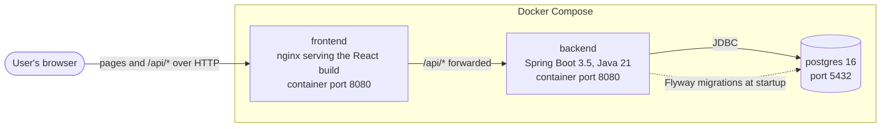
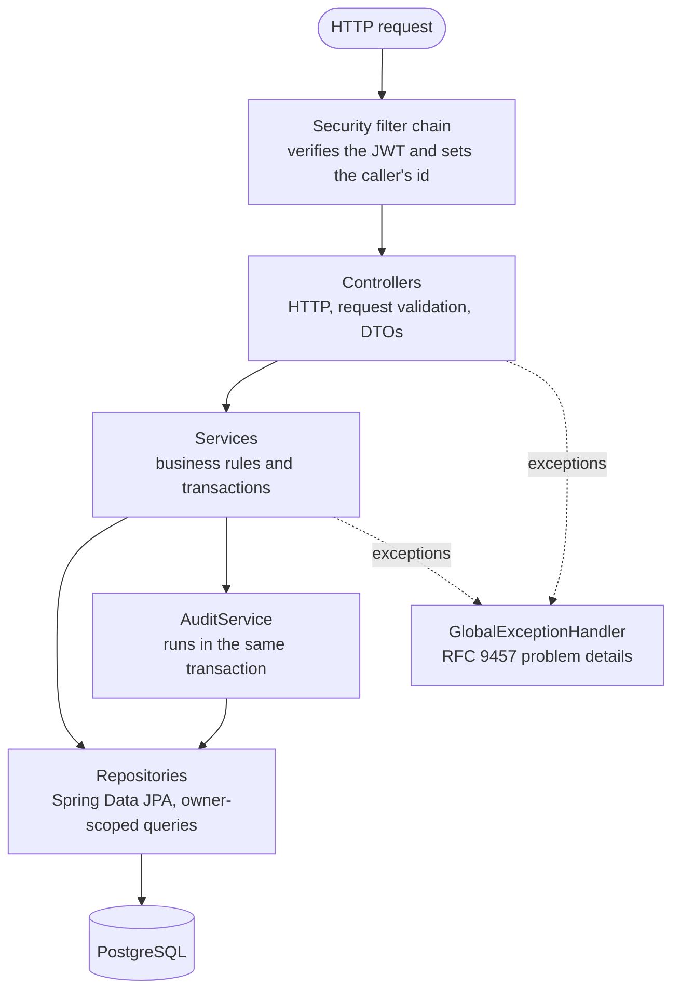
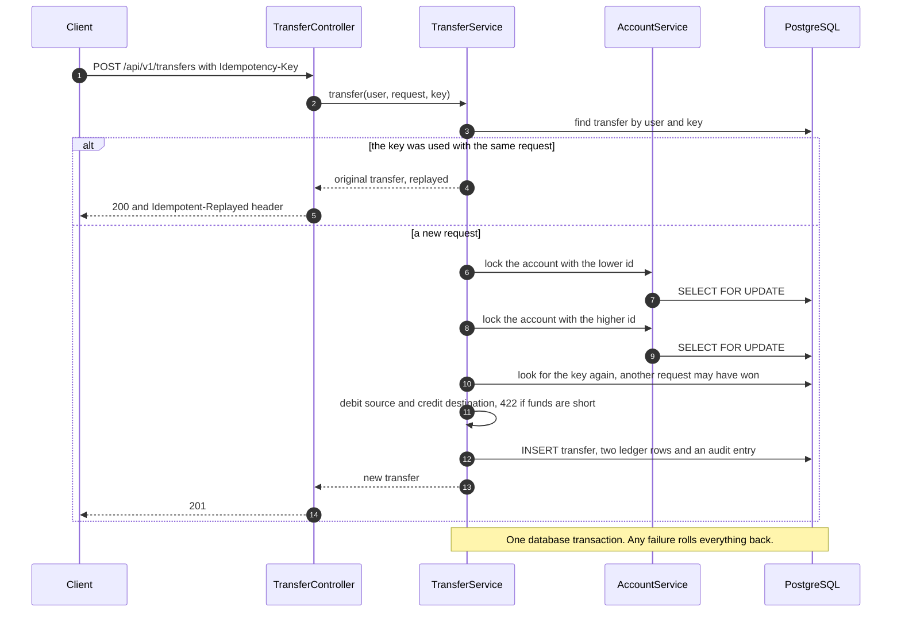
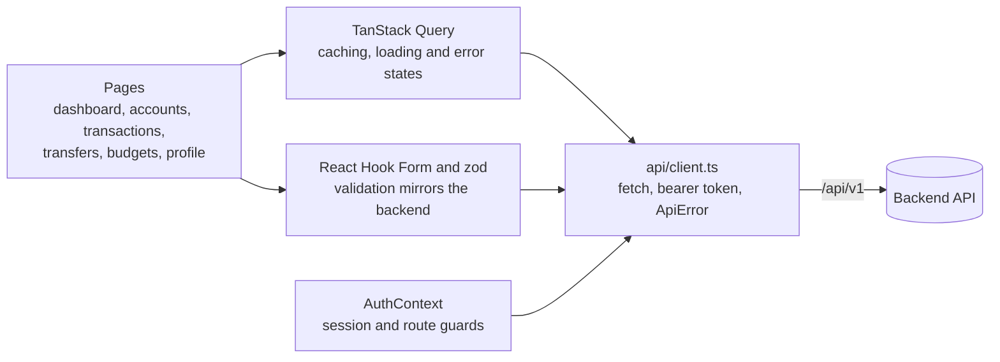

# Architecture

FinTrack is a React single-page app, a layered Spring Boot API and a PostgreSQL database. The three
run as separate containers; the browser only ever talks to one origin. The database design and ER
diagram are in [DATABASE_DESIGN.md](DATABASE_DESIGN.md).

## System overview

- **One origin.** nginx serves the static site and forwards `/api` to the backend, so the backend
  needs no CORS configuration and is not exposed to other origins. The same setup is used in
  development: Vite's dev server proxies `/api`.
- **Ports** are published to `localhost` only: web 3000, API 8080 (for Swagger UI and Postman),
  database 5432.
- **Configuration** comes from environment variables. The database password and the JWT signing
  secret have no defaults, and Compose refuses to start without them.

## Backend: layers and cross-cutting concerns

Packages are organised by feature (`account`, `transaction`, `transfer`, `category`, `budget`,
`dashboard`, `audit`, `auth`, `user`) with shared code in `common`, `security` and `config`.

| Layer | Responsibility | Rule it follows |
| --- | --- | --- |
| Controller | Translate HTTP to a service call and back | No business logic; entities never leave the service layer, DTOs are returned |
| Service | Business rules, transactions, calling other services | `@Transactional`; the only place that changes balances |
| Repository | Persistence | Every lookup takes the owner's user id, so another user's data looks like it does not exist |
| Database | Final guard | `CHECK`, `UNIQUE` and foreign keys back the rules up even if code has a bug |

## Request flow: a money transfer

The transfer is the most demanding operation: it must be atomic, idempotent and safe under
concurrency.

## Frontend

- Pages are loaded on demand, so the charting library is not part of the login page download.
- A `401` on a request that carried a token ends the session and clears all cached data.
- Anything that moves money refreshes accounts, history, dashboard and budgets together.

## Key decisions and their trade-offs

| Decision | Why | Trade-off |
| --- | --- | --- |
| Cached `current_balance` plus a ledger of transactions | Fast reads, and a single row to lock for fund checks | The two can drift if a code path forgets to update both. Mitigated by one service method for all balance changes, a `CHECK`, and tests that replay the ledger |
| Pessimistic row locks for balance changes | Concurrent debits are serialised and cannot overdraw | Contention on a busy account; transfers lock two rows in ascending id order so opposite transfers cannot deadlock |
| Reversal instead of deleting a transaction | History stays complete and auditable | The list hides reversed rows by default and needs a "show reversed" option |
| Idempotency key per user on transfers | A retried request cannot move money twice | Clients must send a key; a reused key with a different body is rejected |
| Spending is calculated, never stored | Budgets and dashboards cannot go out of date | Every read aggregates in SQL (indexed, one query per currency) |
| One currency at a time | Amounts in different currencies cannot be added | No conversion; transfers between currencies are refused |
| JWT in `localStorage` | Simple, survives a reload, no server session | Readable by any script that runs in the page (XSS). A cookie-based session with a refresh token would be stronger |
| Flyway owns the schema, Hibernate only validates | Reviewable, versioned changes and a data-migration test | A mistaken migration needs a new migration to fix it |
| Another user's resource returns 404, not 403 | Existence of other users' data is not revealed | Slightly harder to debug a wrong id |
