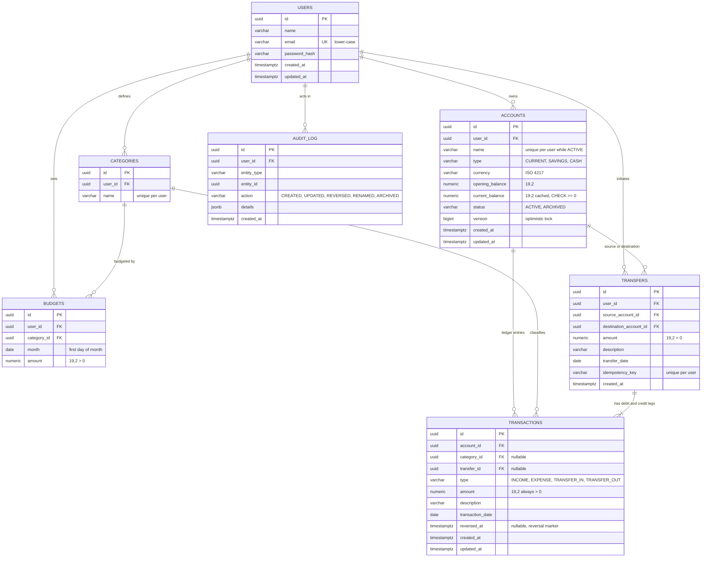

# Database Design

PostgreSQL schema managed by Flyway. Tables marked **(built)** exist in a migration today;
the rest are the agreed design and will be added in the phase named next to them. Details
of a not-yet-built table may be refined when it is implemented, and this document will be
updated in the same commit.

## ER diagram



| Table | Phase | Status |
| --- | --- | --- |
| `users` | 2 | built |
| `accounts` | 3 | built |
| `transactions` | 4 | built |
| `transfers` | 5 | built |
| `categories` | 6 | built |
| `budgets` | 6 | planned |
| `audit_log` | 5 | built |

**Note on transaction categories.** Transactions used to carry a free-text label. The category migration created one `categories` row per user for each distinct label (labels differing only in letter case became one category), pointed each transaction at its category through `category_id`, and dropped the text column. A test runs that migration against rows written under the old schema. The transfer link (`transfer_id`) was added by the transfers migration, with a CHECK that only transfer legs carry it and a unique index so each transfer has exactly one debit and one credit leg.

## Relationships in plain language

- A **user** owns many **accounts**, **categories** and **budgets**. Every one of these rows
  carries `user_id` (or reaches it through the account), and every query is filtered by the
  caller's id. This is how one user is prevented from reading another's data.
- An **account** has many **transactions**. A transaction always belongs to exactly one account.
- A **transfer** is one business event that produces **two** transaction rows: a
  `TRANSFER_OUT` on the source account and a `TRANSFER_IN` on the destination. Both reference the
  transfer, so history shows both sides and they can never be edited independently.
- A **budget** is a spending limit for one category in one calendar month. Actual spending
  is not stored; it is calculated from transactions with a SQL aggregate.
- **audit_log** is append-only: who did what to which entity and when.

## Account balance: cached value or calculated from the ledger?

**Decision: both, with the ledger as the source of truth.** Every change is a row in
`transactions`. `accounts.current_balance` is a cached copy that is updated in the same
database transaction as the ledger row, so the two cannot drift apart through the API.

The invariant, which a test will check against real data:

```
current_balance = opening_balance
                + sum(INCOME, TRANSFER_IN amounts)
                - sum(EXPENSE, TRANSFER_OUT amounts)        (ignoring reversed rows)
```

| | Cached `current_balance` (chosen) | Calculated on every read |
| --- | --- | --- |
| Read speed | One row | Sum over the account's whole history; slows as history grows |
| Insufficient-funds check | Compare against one locked row | Needs a sum under a lock, so it is easy to get wrong |
| Risk | Can drift from the ledger if a code path forgets to update it | None, there is only one source |
| Mitigation | All balance changes go through one service method; the row is locked while changing; a CHECK forbids a negative balance; a consistency test replays the ledger | n/a |

Why this is the practical choice: the dashboard and every transfer need the balance
constantly, and a transfer must check funds and debit atomically. Keeping the number on the
account row gives a single row to lock for that.

### How consistency is protected

- **One transaction per operation.** Ledger row(s) and balance change(s) are written inside
  one Spring `@Transactional` method, so they commit or roll back together.
- **Pessimistic lock for balance changes.** The service reads the account with
  `SELECT ... FOR UPDATE`, so two concurrent debits on the same account run one after the
  other and the second sees the updated balance. A transfer locks both accounts in a fixed
  order (by id) so two opposite transfers cannot deadlock.
- **Optimistic version for everything else.** `accounts.version` makes a stale update (for
  example a rename racing with a balance change) fail instead of silently overwriting the
  balance.
- **Database as the last line of defence.** `CHECK (current_balance >= 0)` rejects an
  overdraft even if application code has a bug.
- **Corrections are reversals, not edits.** Deleting a transaction marks it reversed
  (`reversed_at`) and applies the opposite balance change in the same database transaction, so
  history is kept. Individual transfer legs cannot be deleted.

## Other decisions

- **`NUMERIC(19,2)` / `BigDecimal` for money**, never floating point. All currencies are
  treated as two decimal places for now (a simplification; zero-decimal currencies are out of scope).
- **UUID primary keys** so ids in URLs are not guessable or enumerable.
- **One currency per account; transfers only between accounts in the same currency.** There is no
  exchange-rate handling.
- **Archiving, not deleting, accounts.** An account can be archived only when its balance is
  zero. Archived accounts accept no new transactions but keep their history. The unique
  account name rule applies to active accounts only, so a name can be reused after archiving.
- **Idempotency for transfers** uses a client-supplied key stored on the transfer with a
  unique `(user_id, idempotency_key)` constraint. A repeated request returns the original
  transfer instead of moving money twice, and the constraint covers two simultaneous retries.
- **Enums stored as `VARCHAR` with a `CHECK` constraint**, readable in SQL and safe to extend.
- **Indexes** follow the queries: `user_id` on owned tables, and
  `(account_id, transaction_date)` on transactions for history and monthly aggregates.
